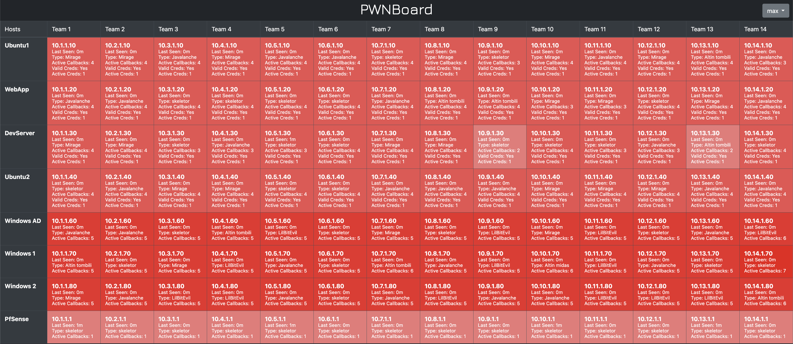

# PWNBoard

**PWNBoard** is a real-time web dashboard for tracking and visualizing beacons from offensive security tools and Command & Control (C2) frameworks during red team engagements and competitions.


## Table of Contents

- [Overview](#overview)
- [Features](#features)
- [Quick Start](#quick-start)
- [Configuration](#configuration)
- [Documentation](#documentation)
- [Acknowledgements](#acknowledgements)

## Overview

PWNBoard provides a centralized dashboard for tracking compromised hosts, active beacons, and harvested credentials across multiple teams during red team operations. This fork enhances the original [ztgrace/pwnboard](https://github.com/ztgrace/pwnboard) and [nullmonk/pwnboard](https://github.com/nullmonk/pwnboard) projects with a lot of really cool features



## Features

- Track active Red Team beacons and captured credentials in a visual dashboard
- Optional tool authentication through access tokens
- Easily manage multiple red teamers with RBAC features
- Beautiful Grafana dashboard for visualizing data
- Quick containerized deploy using Docker

## Quick Start

### Prerequisites

- Ensure the Docker Engine is installed on your machine
- Python 3.x
- Ports 80, 443 and 8443 free on the host (Caddy serves HTTPS on all three)
- To use a public domain name: its DNS record must point at the host, and ports 80 and 443 must be reachable from the internet so Caddy can get a Let's Encrypt certificate

### Guided Setup

The setup script walks you through everything below (`.env` and `board.json`) in one go:

```bash
python3 scripts/setup.py
```

It prompts for the domain, admin password and Flask secret key (it can generate a random secret for you), then launches the board generator. It asks before overwriting an existing `.env` or `board.json`. When it finishes, skip ahead to [Deploy](#deploy).

If you would rather configure things by hand, follow the next two sections.

### Board Setup

PWNBoard requires a topology configuration to define teams and hosts. Generate your board configuration using the included Topology Generator:

1. **Create a board file** using `gen_config.py`:
   ```bash
   python3 scripts/gen_config.py
   ```

Follow the steps in the script to define your hosts. This will generate a `board.json` in the project root, necessary for PWNBoard to deploy correctly.

### Environment Setup

1. **Configure environment**:

Start by changing the values in the `.env` file. You must edit these for a secure configuration, especially if you are exposing PWNBoard to the internet.

   ```yaml
   PWNBOARD_DOMAIN=localhost # Hostname or IP that PWNBoard is served on (ex. pwnboard.win, 10.1.1.10). No https:// and no port
   SECRET_KEY=change-me-please # Flask secret used for signing session cookies
   PWNBOARD_PASSWORD=password # Default password for PWNBoard/Grafana
   GRAFANA_DB_PASSWORD=... # Optional: password of the read-only database user Grafana uses (defaults to PWNBOARD_PASSWORD). scripts/setup.py generates one
   HOST_TIMEOUT=5 # Optional: amount of time (in minutes) after which a host with no new callback is shown as offline. The web app and the worker both use it
   CREDS_TIMEOUT=30 # Optional: amount of time (in minutes) after which credentials are shown as stale. The web app and the worker both use it
   ```

Edit optional paramters in the docker-compose.yml file. Here are some variables that you can change to best suit your needs.

   ```yaml
   - REFRESH_SECONDS=10 # Change this to the amount of time (in seconds) after which you want your page to refresh with new data. Setting this to 0 or -1 will disable refreshing
   - DEFAULT_USER=admin # This will be your default user
   - LOGIN_PAGE_MESSAGE=Contact an admin to get an account! # Change this if you want your welcome message on the home page to be different
   - USE_ACCESS_TOKENS=true # Set this to false to disable the use of access tokens for authenticating POST requests
   ```

2. **HTTPS is automatic**:

[Caddy](https://caddyserver.com) handles certificates, so there is nothing to generate. What you get depends on `PWNBOARD_DOMAIN`:

   - **A public domain** (ex. pwnboard.win): Caddy requests a Let's Encrypt certificate on first start (see the prerequisites above).
   - **`localhost` or an IP address**: Caddy signs a certificate with its own internal CA. Browsers will warn, and you will need to skip certificate validation when POSTing data (ex. `curl -k`), or trust Caddy's root certificate. See [doc/setup.md](doc/setup.md#3-self-signed-certs-and-failed-post-requests).
   - **A private hostname with no public DNS** (ex. pwnboard.red.team): Let's Encrypt cannot validate it, so add `tls internal` inside both site blocks of `conf/reverse-proxy/Caddyfile` to use the internal CA instead.

### Deploy

1. **Start PWNBoard with Docker Compose**:
   ```bash
   docker compose up -d
   ```

2. **Access the PWNBoard dashboard**:
   - Navigate to `https://<PWNBOARD_DOMAIN>` in your browser
   - Login with default credentials set up in environment variables!

3. **Access Grafana**:
   - Navigate to `https://<PWNBOARD_DOMAIN>:8443` in your browser
   - Login with admin:PWNBOARD_PASSWORD

For detailed setup instructions and troubleshooting, see [doc/setup.md](doc/setup.md).

### Key Environment Variables

For a complete list of configuration options, see [doc/config.md](doc/config.md).

## Using PWNBoard

See the [usage guide](doc/usage.md) for detailed instructions on how to send data to PWNBoard!

## Documentation

- **[Setup Guide](doc/setup.md)** — Detailed deployment instructions and troubleshooting
- **[Configuration Reference](doc/config.md)** — Complete environment variable reference
- **[Development Guide](doc/development.md)** — Architecture, file structure, and contribution guidelines

## Testing your PWNBoard deployment

The [sim_callbacks](scripts/sim_callbacks.py) and [sim_creds](scripts/sim_creds.py) testing tools can be used to test your PWNBoard deployment!
1. Log into PWNBoard

2. If `USE_ACCESS_TOKENS=true`, create an access token at `/manage_apps` with the application name `global` and copy it. If you don't want to input it into the script, you can configure an environment variable `ACCESS_TOKEN` on your local machine.

3. Run the Python script
```bash
python3 scripts/sim_callbacks.py [/path/to/board/file]
```
or
```bash
python3 scripts/sim_creds.py [/path/to/board/file]
```

4. If board file was not specified, follow the script instructions to set up IP addresses to POST to

5. Include your `global` Access Token when prompted (if using access tokens)

6. Include the full POST endpoint URL of your PWNBoard (ex. https://www.pwnboard.win/pwn, https://10.1.1.11/pwn, https://www.redteam.win/creds)

7. Before the real deployment, clear the test data. See [Resetting test data](doc/setup.md#resetting-test-data) to do this while keeping your users and access tokens.

## Troubleshooting/Known Issues

For troubleshooting tips, check the bottom of the [setup guide](doc/setup.md).

## Feature Wishlist

To view the PWNBoard feature wishlist, please navigate to the [Issues](https://github.com/max-49/pwnboard/issues) tab on GitHub and look for issues that start with `FEATURE REQUEST`!

## Contributing

Contributions are welcome! Please:

1. Fork the repository
2. Create a feature branch
3. Make your changes with clear commit messages
4. Test thoroughly
5. Submit a Pull Request

See [doc/development.md](doc/development.md) for detailed contribution guidelines.

## Acknowledgements

This project builds upon the work of:
- **[ztgrace/pwnboard](https://github.com/ztgrace/pwnboard)** — Original PWNboard
- **[nullmonk/pwnboard](https://github.com/nullmonk/pwnboard)** — Improvements for RIT Red Team
- **[RITRedteam/Topology-Generator](https://github.com/RITRedteam/Topology-Generator)** — Topology generation tool

## License

This project inherits the licensing from its upstream repositories. See original projects for specific license terms.

---

**Questions or Issues?** Open an issue on GitHub.
